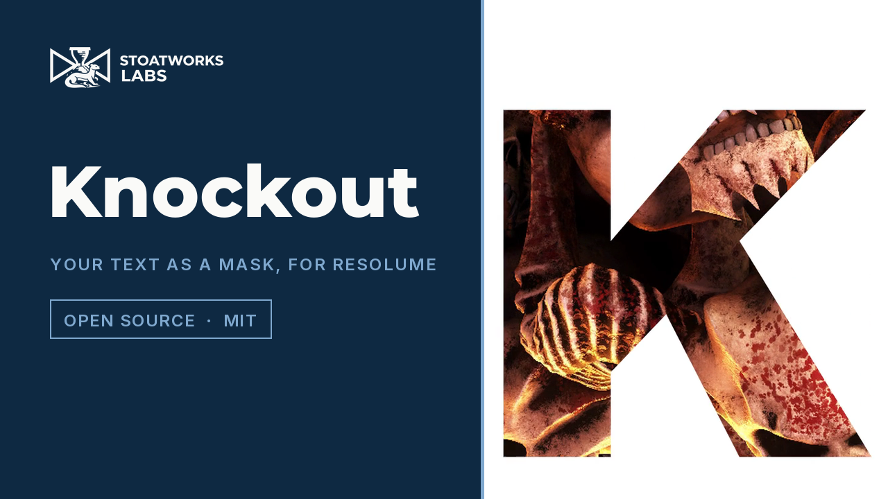

# knockout

> **AI-assisted project.** This codebase was created with [Claude](https://claude.com/claude-code)
> (Anthropic), directed and reviewed by a human author. It has been **loaded into Resolume
> Arena 7.28.1 on one Mac** and driven there over Arena's REST API rather than by hand:
> every control changes Arena's output, Mix 0 hands back the clip to the bit, and a saved
> composition reopens to the same picture, on this Mac's fonts and on a different set. Its
> Windows build has been through the fleet's Arena gate, on software rendering.
> Everything else below is measured by an
> offline harness that drives the real plugin class in a headless GL context on this Mac's
> GPU. Every pixel of the mask agrees with the test font's own geometry **within 0.0005**,
> curves and 40× zooms included. A stroke 1000× zoomed, on the sixteenth letter of a line,
> at 4K, is still **within 0.0018**. And six faces nobody here drew (TrueType and CFF,
> upright and italic, two variable fonts with overlapping strokes) match stb_truetype's own
> rasteriser with no pixel in on one side and out on the other. `kotest --negative` re-runs
> the checks against eight deliberately wrong models, and `tools/mutate.sh` changes one
> character of the shipped shaders and code twenty-three times. Every one is caught.

Your words, in any font you have installed, as a mask over the clip, for Resolume
Arena/Avenue. The clip shows through the letters (**Inside**), or the letters are cut out
of it (**Outside**), and whatever the mask takes away becomes transparent, black, white or
a colour of your choosing. One FFGL effect: **SW Knockout**.

The letters aren't a picture of the text. Every frame, every pixel asks the font's own
curves whether it's inside a letter and how far from the edge, so a word stays sharp
whether it fills the frame or you've zoomed a thousand times into one stroke of it.


<sub>Rendered by the plugin's offline harness (`kotest`) over frames of Resolume's
*Beat 002*, *Beat 004*, *Beat 006* and *Beat 001*, not captured from Resolume. The
defaults on Black; Outside on Colour in Futura Bold; Didot Italic with Outline; and
Didot's R at Zoom 50 about its tail.</sub>

**[Try it in your browser](https://knockout-demo.stoatworks-labs.com)**: the plugin's own C++
compiled to WebAssembly, drawing with its own shaders in WebGL2, every control there. A web
page can't see your fonts, so it brings four of its own (Anton, Barlow, DM Serif Display and
Monoton, all under the OFL), and Font File takes one of yours without uploading it. It's a
demo rather than the plugin, and the page says where the two differ. Its pixels agree with
`kotest`'s, given the same fonts and clip, to within one level in 255
(`demo/tools/crosscheck/`).

<!-- downloads:start -->

## Download

**[v0.1.0](https://github.com/stoatworks-labs/knockout/releases/tag/v0.1.0)** — prebuilt for macOS and Windows. Pick your platform:

<details>
<summary><b>macOS</b> — Universal (Apple Silicon + Intel)</summary>

| Build | Download | Size |
| --- | --- | --- |
| Universal (Apple Silicon + Intel) · .dmg disk image | [`knockout-0.1.0-macos-universal.dmg`](https://github.com/stoatworks-labs/knockout/releases/download/v0.1.0/knockout-0.1.0-macos-universal.dmg) | 588 KB |
| Universal (Apple Silicon + Intel) · .zip archive | [`knockout-macos-universal.zip`](https://github.com/stoatworks-labs/knockout/releases/latest/download/knockout-macos-universal.zip) | 261 KB |

</details>

<details>
<summary><b>Windows</b> — x64</summary>

| Build | Download | Size |
| --- | --- | --- |
| x64 · .exe installer | [`knockout-0.1.0-windows-x86_64-setup.exe`](https://github.com/stoatworks-labs/knockout/releases/download/v0.1.0/knockout-0.1.0-windows-x86_64-setup.exe) | 275 KB |
| x64 · .zip archive | [`knockout-windows-x86_64.zip`](https://github.com/stoatworks-labs/knockout/releases/latest/download/knockout-windows-x86_64.zip) | 174 KB |

</details>

All builds, checksums and release notes: [github.com/stoatworks-labs/knockout/releases](https://github.com/stoatworks-labs/knockout/releases).

The Windows builds are unsigned, so SmartScreen warns once.

<!-- downloads:end -->

## Video

[](https://www.youtube.com/watch?v=HTvyaKAG3Vc)

*[Watch it](https://www.youtube.com/watch?v=HTvyaKAG3Vc), 89 seconds: Inside and Outside on
each Background, Didot Italic to Chalkduster and Avenir Next's six weights, Grow, Feather and
Outline, two lines with Align, Tracking and Rotation, both Reveals, and a zoom from 1× to
1000× into the tip of the K's arm. Every frame is the plugin's own output, rendered by
`kotest` over Resolume's demo clips, not captured from Resolume.*

## The one idea

A glyph in a font is a handful of curves. The plugin sends each glyph's curves to the GPU
once, and then draws one rectangle per letter on the screen. Every pixel in that rectangle
works out two things from the curves directly: whether it's inside the letter (a ray to
the right, counting the curves it crosses and which way they go, as TrueType and CFF fill
their outlines), and how far it is from the nearest edge, exactly, in pixels. Inside and
distance together give the mask: a one-pixel ramp across the edge, so it's antialiased at
any size, and **Grow**, **Feather** and **Outline** are the same ramp moved, widened or
folded into a stroke.

No atlas, so nothing to run out of resolution. Zoom is handled in double precision on the
CPU and the shader only ever works with numbers near the middle of the screen, which is
why the thousandth zoom into the end of a long line still lands where it should (`--zoom`).

Letters whose strokes overlap, as a variable font's default instance usually does, are
cleaned up when the font loads: the bits of outline that sit inside another stroke still
count towards inside and out, but not towards the edge, so a filled letter has no seam and
an outlined one has no stroke through the middle of its crossbar (`--overlap`).

## Fonts

- **Font** lists the families on this machine when the plugin loads. A family picked from
  it is saved as a number made from its name, not its place in the list, so the
  composition finds the same family on a machine with a different set of fonts. On one
  without it, the plugin draws its default (Arial Black, or Arial where there's no Arial
  Black), the list shows nothing picked, and the composition keeps the choice for the next
  machine that has it.
- **Font Name** is the same choice typed (any case), and it wins over the list. A name the
  machine hasn't got is kept as typed while the plugin draws the default, until you pick
  something else. Picking from the list fills it in for the plugin, but Arena never shows
  that, so in Arena the field stays as you left it.
- **Weight** and **Italic** pick a face from the family the way a browser does: the nearest
  weight it has (500 looks down before up, above 500 looks up first, below 400 looks down),
  and an italic before a weight.
- **Font File** takes a `.ttf`, `.otf`, `.ttc` or `.otc` from anywhere and overrides the
  lot. That's also the way in to the faces macOS keeps out of font menus (their names start
  with a dot, like New York's `.New York`).
- TrueType and CFF outlines are both read. CFF's cubic curves become quadratics within
  2e-5 em of the originals.

What isn't there: any shaping. Letters are placed one after another with the font's
advances and kerning pairs, so Latin, Greek and Cyrillic are fine, ligatures don't happen,
and Arabic, the Indic scripts and anything else that needs its letters joined or reordered
will come out as a row of the wrong shapes. Faces whose glyphs are bitmaps (Apple Color
Emoji) and CFF2 variable fonts are left out of the list, because there are no curves to
read.

In the **Text** field, `\n` starts a new line (so does a real line break, if your host
lets you type one) and `\\` is a backslash. Up to 4096 characters are drawn.

## Controls

- **Text:** Text, Font, Font Name, Font File, Weight (*Thin* to *Black*), Italic.
- **Layout:** Fit (*Frame*, *Width*, *Height*: the text scaled to fill it, less Margin;
  *Size*: Size sets the em, 0.02 to 2 frame heights), Size, Margin (0 to 0.45 of the frame
  on each side), Align (*Left*, *Centre*, *Right*, between lines), Tracking (−0.2 to
  +0.6 em between letters), Line Spacing (0.5 to 2 lines).
- **Transform:** Position X and Y (±1 frame), Rotation (±180°), Zoom (1 to 1000 times),
  Zoom X and Y (where on the frame the zoom is centred).
- **Edge:** Grow (±0.1 em, the outline pushed out or pulled in), Feather (up to 0.1 frame
  heights of soft edge), Outline (0 for filled letters, up to 0.2 em of stroke centred on
  the outline).
- **Reveal:** Reveal (0 nothing, 1 everything), Reveal Spread (0 one letter at a time,
  1 every letter fading together), Reveal Order (*Forward*, *Backward*, *Centre Out*,
  *Random*). Put Reveal on a Resolume envelope or the BPM and the text writes itself on.
- **Mask:** Mask (*Inside*, *Outside*), Background (*Transparent*, *Black*, *White*,
  *Colour*), Colour, Mix (0 hands back the clip untouched, to the bit).

The default is the word KNOCKOUT in Arial Black (Arial, on a machine without it), filling
the frame, with the clip showing through it on transparency.

## Status

**v0.1.0**, the first release. Loaded into Resolume Arena on one Mac, and on Windows on
software rendering; everything else is measured offline on one Mac. There's a
[user guide](https://stoatworks-labs.com/software/knockout/guide/).

### Measured offline, on macOS

`tools/verify.sh` passes on this machine (Apple M4 Max, macOS 26.4.1) against a fresh
universal Release build (2 November 2026). The checks run on four test fonts that
`tools/make-test-font.py` writes, whose every glyph is a shape the harness knows exactly:
squares, a square with a square hole, two bars crossing, triangles, and a disc of eight
quadratics. What they establish:

| check | result |
| --- | --- |
| `--coverage` | twelve settings (lines, alignment, tracking, rotation, zoom about a point, all at once, the disc's curves, 40× onto a curve) at two rasters: every pixel within **0.0005** of the coverage the shapes predict |
| `--zoom` | an edge at 10×, 100× and 1000×, and the sixteenth letter of a line at 1000× at 4K, within **0.0018** (a float version of the same arithmetic is out by 0.037) |
| `--edge` | Grow, Feather and Outline within **0.0005**; Grow ±0.05 em changes an H's width by 0.1 em to within **0.0005 px**; Feather keeps the edge where it was; strokes of 0.3 to 2 px draw the ink the ramp predicts |
| `--overlap`, `--winding` | crossing strokes draw as one shape: no seam filled, no stroke inside outlined; O's hole empty, X's doubled middle full |
| `--layout`, `--fit`, `--transform` | advances, kerning, tracking, three alignments to **0** font units; each Fit to **0.02 px**; Position, Rotation and Zoom to **0.01 px** and **0.05°** |
| `--reveal` | all four orders at three Spreads: each letter's alpha exactly as the formula, the picture within **0.0005**; Random the same order in every instance |
| `--composite` | Inside and Outside on each Background, at Mix 1, ½ and 0, within **6e-8**; Mix 0 the clip bit for bit |
| `--fonts`, `--text` | weight matching, italic, Font Name over the list, Font File over both, a missing name kept; the list's values follow each family's name, not its position, and a value from another machine finds its family or the default; escapes, empty text, 5000 characters |
| `--stb` | the test fonts against stb_truetype's rasteriser: no pixel in on one side and out on the other, area within **0.013%** |
| `--state`, `--resize` | the host's GL state comes back as it went in; a new raster under a running instance |
| `--controls` | all **30** controls change the picture |
| `--real` | this Mac's fonts: Arial Black, Helvetica, STIXGeneral (CFF) upright and italic, the system font and New York (both variable, with 43 and 32 overlapping pieces) against stb_truetype at 720p: no hard disagreement, area within **0.1%**; all 335 families' list values exact in a float, no two alike |
| `--negative` | **8** deliberately wrong models (even-odd fill, distance to every piece, a two-pixel ramp, no kerning, Grow inverted, overlaps left in, the centre in float, the harness's own rotation backwards), **8** caught |
| mutation | **23** one-character mutants of the shipped GLSL and C++, **23** caught |
| shaders | all 4 compile through `glslc`, not merely through Apple's driver |
| software renderer | every check above but `--real` passes again on Apple's software renderer |
| the bundle | universal (`x86_64 arm64`), exports `plugMain`, ad-hoc signs; `oxbow` reports `SW Knockout` / `KO01` / `effect` and renders 120 frames through it |

Cost on the same Mac, GPU finished: the defaults take 0.13 ms a frame at 1080p and 0.57 ms
at 4K; eight lines of 56 characters 0.29 ms and 0.77 ms; a word zoomed 1000× into a stroke
0.46 ms and 1.73 ms (`kotest --system-fonts --bench`).

### In Resolume Arena, on macOS

Arena 7.28.1 (rev 26535) on the same Mac, 2 November 2026: Knockout as a layer effect over
a 1920×1080 still, driven over Arena's REST API, with the composition's output read back as
snapshots. Nobody sat at it and nothing was played to anybody.

- Arena lists **SW Knockout** with its description and its 34 parameters (plus Arena's own
  Opacity). The User guide button has made it 35 since.
- **All 30 controls change Arena's output**, and each reads back the value it was given.
- Background *Transparent* is alpha 0 in Arena's output. **Mix 0 is identical to the effect
  bypassed**, to the bit, with Mask *Inside* and *Outside*, each on *Transparent* and on
  *Colour*.
- **Save, new, open:** the settings and the picture come back bit for bit, both for a family
  picked from the list (Didot Italic) and for a typed Font Name (Futura Bold Italic,
  *Outside*, on *Colour*).
- **On another machine's fonts:** Arena relaunched with the plugin reading a folder of six
  families (`KNOCKOUT_FONT_DIR`) in place of this Mac's 335. Didot Italic, picked from the
  list where it was 56th, came back as Didot Italic, fourth in the short list, the picture
  identical to the bit. Copperplate, which the folder hasn't got, drew Arial Black with a
  warning in the log; Arena's list showed nothing picked, and saving the composition again
  kept Copperplate's value.

One thing Arena does that you'd want to know before a show:

- **A clip smaller than the composition** reaches a layer effect inset in a
  composition-sized frame, so the text fills the composition and only the letters over the
  picture have anything to show: a 1280×720 clip in a 1080p composition loses the K and the
  T. Set the clip's Resize to *Fill* and the clip is the whole frame.

Not tried: Avenue, Knockout as a clip effect, a second real Mac (a different font folder on
this one stood in for it), and what it costs per frame inside Arena.

### On Windows

Built by CI (windows-2022, MSVC, static GLEW from vcpkg) and loaded the way a host loads
it (`tools/wincheck.ps1`), 2 November 2026: the DLL reports **SW Knockout** / `KO01` /
effect with its 35 parameters, and its font scan lists the 76 families in the runner's
`C:\Windows\Fonts`, each with its own value. Arial's is the number a Mac gives it, so a
family picked on a Mac opens as the same family on a PC that has it. The runner has no
family called Arial Black, so a PC like it starts on Arial instead.

The fleet's Arena gate (`arena/` in plugin-bench) then ran the release workflow's own Windows
build in **Resolume Arena 7.27.1** on win-lab, a Windows VM with no GPU (Mesa's llvmpipe), the
same day. The DLL loads and registers as `SW Knockout`, `KO01`, an effect; all 36 controls
(Arena's Opacity and the plugin's 35) arrive with the names, order, types, ranges and defaults
declared; it draws with a font loaded from a file (KaTeX Main, which win-lab hasn't got
installed); and Arena's log stays clean: **10 passed, 0 failed, 0 skipped**. Against Arena's
still test picture, 28 controls measurably changed the frame, which is every one that can be
probed: Text, Font Name and the About block are strings, and Font File is a path. win-lab has
no Arial Black either, and its Font list starts on Arial.

The installer, built by release-lib's `--ffgl` from that DLL, was run there silently.
`Knockout.dll` went into `Documents\Resolume Arena\Extra Effects`, its README, notices and
uninstaller into a `Knockout` folder beside it, and its uninstall entry into the user's
registry, not the machine's. Arena, restarted, listed SW Knockout; the uninstaller took all of
it away again. Software rendering says nothing about a GPU or about speed, and nobody has sat
at it on Windows.

### Known limits

- **No shaping** (see Fonts): scripts that join or reorder their letters come out wrong.
- **Hairlines get heavier rather than fainter.** An Outline thinner than a pixel draws
  (1 + w)² / 4 px of ink, not w: 0.42 px for a 0.3 px stroke. That's the one-pixel ramp
  doing what it does at both edges at once, and it's measured (`--edge`).
- **CFF curves are approximated** by quadratics, within 2e-5 em: under 0.05 px even for
  a letter filling a 4K frame. Zoom multiplies it, so at Zoom 1000 a CFF curve can sit
  tens of pixels off the designer's. It's still a smooth curve; it's just not quite theirs.
  TrueType fonts are quadratics already and have no such error.
- **Two family names can, rarely, share a list value.** The second of the pair then takes
  the next number up, so it travels only to machines that have both. With 335 families, as
  here, about one machine in 300 has such a pair; this one has none (`--real` counts them).
- **A face is read once per load.** Install a font while Resolume is running and it
  appears in the list next time the plugin loads; Font File reaches it in the meantime.

## Build

Needs CMake 3.15+, a C++17 compiler and the FFGL SDK submodule:

```bash
git submodule update --init --recursive
```

```bash
cmake -B build -DCMAKE_BUILD_TYPE=Release
```

```bash
cmake --build build -j8
```

```bash
cmake --install build
```

The last one puts `Knockout.bundle` into `~/Documents/Resolume Arena/Extra Effects`. The
macOS build is universal (Apple Silicon and Intel). On Windows, GLEW would come from vcpkg
(`vcpkg.json`).

## Building and testing

The harness is `build/kotest`. It renders through the real plugin class:

```bash
./build/kotest --system-fonts --out /tmp/frame.png --set "Text=Hello" --set "Font Name=Futura"
```

```bash
tools/verify.sh
```

`tools/verify.sh` is everything: shader hygiene, `glslc`, the test fonts checked against
their script, a fresh universal build with no warnings, the bundle through `lipo`, its
plist and oxbow, every check on this GPU and again on Apple's software renderer, this
Mac's own fonts, the pipe, the negative controls, the mutants and the bench. `CLAUDE.md`
lists what each check measures; `AGENTS.md` says why the plugin is built the way it is.

CI (`.github/workflows/ci.yml`) runs on every pull request and every push to `main`: on
macOS, `kotest --offline`, every pixel check on the software renderer and the shaders
through `glslc`; on Windows, the build and `tools/wincheck.ps1`.

## License

MIT. See [LICENSE](LICENSE) and [ATTRIBUTIONS.md](ATTRIBUTIONS.md).

<!-- attributions:start -->
This project is built on other people's work — see [ATTRIBUTIONS.md](ATTRIBUTIONS.md).
<!-- attributions:end -->
