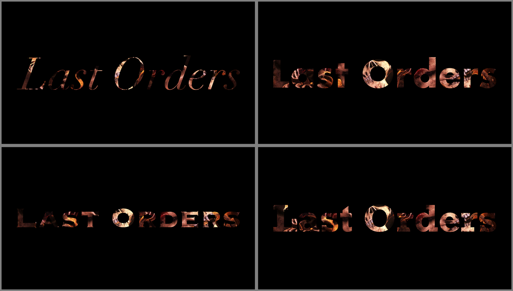
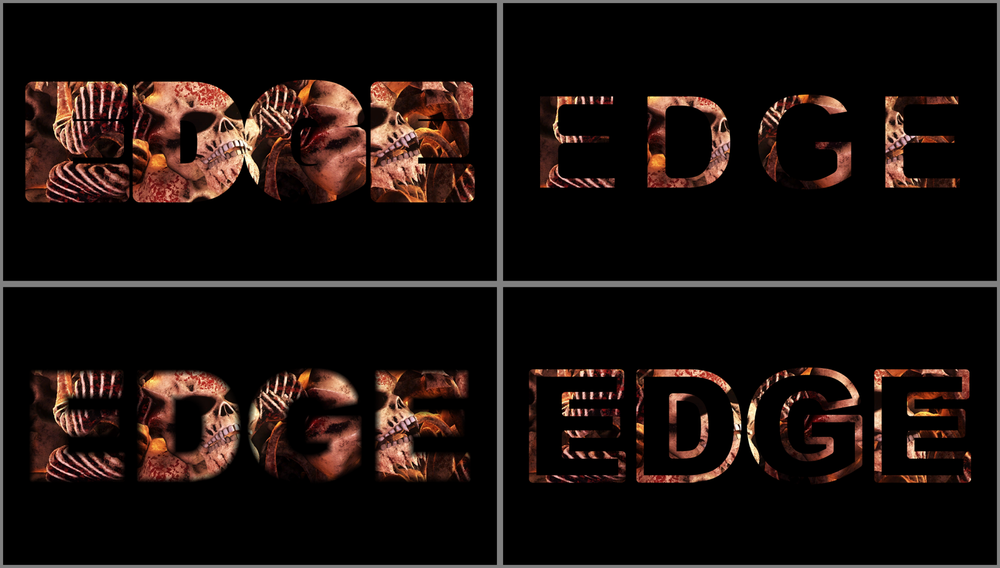
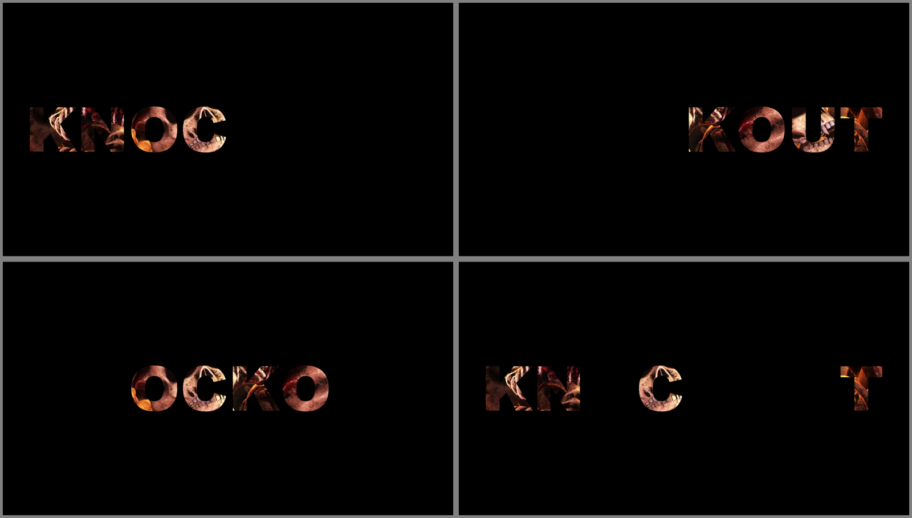
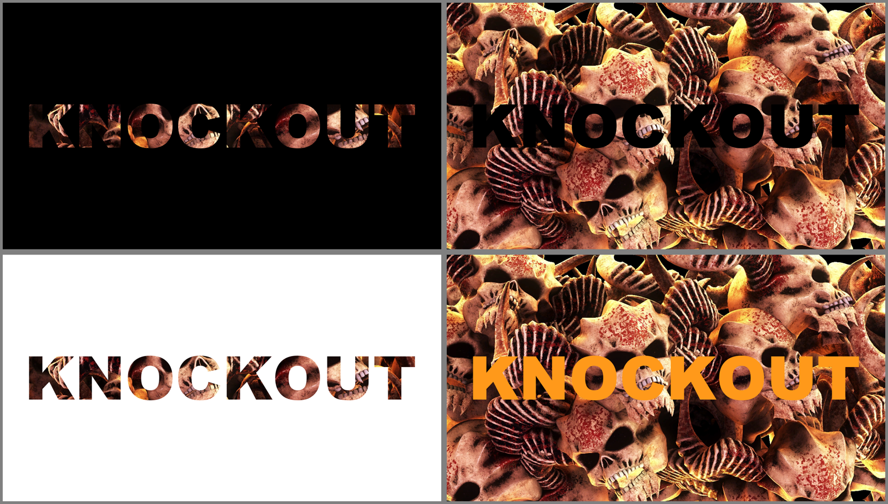

# Knockout user guide

Knockout is **your words as a mask over the clip, for [Resolume](https://resolume.com) Arena and
Avenue**: one FFGL effect, **SW Knockout**. Type something, pick a font, and the clip shows through
the letters (**Inside**) or has them cut out of it (**Outside**). Whatever the mask takes away
becomes transparent, black, white or a colour of your choosing, so it works as a title over the
layers below, or as a stencil all on its own.

The letters aren't a picture of the text. A glyph in a font is a few dozen curves, and every frame
each pixel works out from those curves whether it's inside a letter and exactly how far it is from
the edge. There's no texture of the alphabet sitting in memory at some resolution, waiting to go
soft, so a word is as crisp filling a 4K frame as it is zoomed a thousand times into the tail of
one R.


*Rendered by `kotest`, the offline harness, rather than captured from Resolume, over frames of
Resolume's Beat 002, Beat 004, Beat 006 and Beat 001: the defaults on Black; LIVE in Futura Bold,
Outside on Colour; Last Orders in Didot Italic with Outline; and Didot's R at Zoom 50 about its
tail.*

> **Before you rely on this:** it's at **v0.1.0**, the first release, and very early days. It has
> been loaded into Resolume Arena 7.28.1 on one Mac and driven there over Arena's REST API rather
> than by hand: every control changes Arena's output and reads back the value it was given, Mix 0
> is identical to the effect bypassed, to the bit, and a saved composition reopens to the same
> picture, on that Mac's fonts and on a different set. Everything else is measured by a harness
> (`kotest`) that drives the plugin's own class in a headless GL context on one Apple Silicon Mac
> (macOS 26), at two sizes and again on Apple's software renderer. Every pixel of the mask is within
> 0.0005 of the coverage that the test fonts' own shapes predict; a stroke zoomed 1000 times, on the
> sixteenth letter of a line, at 4K, is within 0.0018; and six real faces (TrueType and CFF, two of
> them variable fonts with overlapping strokes) agree with stb_truetype's own rasteriser, with no
> pixel in on one side and out on the other. Eight models that are wrong on purpose and 23
> one-character changes to the shipped code are all caught.
> On Windows, the release workflow's own build has been through the fleet's Arena gate on a
> machine with no GPU (Arena 7.27.1, software rendering): it loads, every control arrives as
> declared, it draws with a font loaded from a file, and every control that can be probed
> changes Arena's picture. Its installer was run there too, and Arena found the plugin where it
> had put it.
> Nobody has played it in a show, it's never been in Avenue, and nothing was timed inside Resolume.
> Try it on a spare layer before you put it in a show.
>
> This codebase was created with AI assistance, directed and reviewed by a human author.

---

## Installing

Every download carries one effect, **SW Knockout** (`Knockout.bundle` on macOS, `Knockout.dll` on
Windows). Drop it into Resolume's effects folder and restart Resolume:

```
macOS    ~/Documents/Resolume Arena/Extra Effects/
Windows  %USERPROFILE%\Documents\Resolume Arena\Extra Effects\
```

Avenue uses the same layout under its own folder name. The effect then shows up in the effects
browser as **SW Knockout**.

The macOS download is a universal build (Apple silicon and Intel), as a `.dmg` or a `.zip`. It's
**Developer ID-signed and notarised**, so the bundle just loads. The Windows download is an x64
installer or a `.zip`. The installer is for you alone, so it asks for no administrator password,
and it starts on Arena's Extra Effects folder (Avenue's, if only Avenue is there); its folder page
names both, if you want the other. `Knockout.dll` goes in that folder, and its README, notices and
uninstaller in a `Knockout` folder beside it, where Resolume pays them no attention. Quit Resolume
first. It isn't code-signed, so it trips SmartScreen once: **More info** → **Run anyway**. Or skip
the installer, take `Knockout.dll` out of the `.zip` and drop it into the folder by hand.

To try it before installing anything, there's a
[browser demo](https://knockout-demo.stoatworks-labs.com): the plugin's own C++ compiled to
WebAssembly, drawing with its own shaders, with every control. A web page can't see your fonts,
so it brings four of its own, and its Font File takes one of yours without uploading it. It's a
demo rather than the plugin, and the page says where the two differ.

---

## Start here

Put SW Knockout on a layer with something bright in it and leave every control where it is. You
get the word KNOCKOUT in Arial Black (Arial, on a machine without it), filling the frame less a
small margin, with the clip showing through the letters and nothing at all round them, so the
layers below show there.

Then, in this order:

1. **Text** to something of your own. `\n` starts a new line.
2. **Background** to **Black**, so you can see exactly where the letters are.
3. **Mask** to **Outside**. Now the letters are holes in the clip.
4. **Font** to any family you have, or type one into **Font Name**. **Weight** and **Italic** pick
   from what the family has.
5. **Outline** up a little: the letters become strokes. **Grow** fattens or thins them; **Feather**
   softens the edge.
6. **Reveal** to 0, then put it on one of Resolume's envelopes or the BPM: the text writes itself
   on, a letter at a time, in the **Reveal Order** you pick.
7. **Zoom** all the way up and move **Zoom X** and **Zoom Y** about. It's still a clean edge at a
   thousand times, which is the point.

---

## How it draws the letters

When you change the text or the font, the plugin reads each letter's outline out of the font file
and sends the curves to the graphics card once. Every frame after that it draws one rectangle per
letter, and every pixel in that rectangle answers two questions from the curves directly:

- **Am I inside the letter?** It counts the curves crossed by an imaginary line running from the
  pixel off to the right, and which way each one goes, which is the rule TrueType and CFF fonts are
  filled by. Holes, like the middle of an O, fall out of the counting.
- **How far am I from the edge?** Exactly, in pixels, to the nearest bit of outline.

Those two together make the mask: a ramp one pixel wide across the edge, so the letters are smooth
at any size. Grow moves that ramp out or in, Feather widens it, and Outline folds it in half to
make a stroke along the outline instead of a fill. They're all the same distance, used three ways.

Zooming is worked out on the processor in double precision, and the graphics card only ever deals
with numbers about as big as the screen, which is why a thousand-times zoom at the far end of a
long line still lands where it should rather than wobbling about.

Letters whose strokes overlap, as variable fonts' letters usually do, are tidied up when the font
loads: the bits of outline that sit inside another stroke still count for inside and outside, but
not for the edge, so a filled letter has no seam and an outlined one has no stroke drawn through
the middle of its crossbar.

---

## The Text group



*Rendered by `kotest` over a frame of Resolume's NoHopeJustFear_44, Background Black. Font Name
Didot with Weight Regular and Italic on; Futura, Copperplate and Rockwell with Weight Bold.*

- **Text** is what's drawn. `\n` starts a new line, and so does a real line break if your host
  lets you type one; `\\` is a backslash. Up to 4096 characters are drawn, which is a lot of
  lyrics.
- **Font** lists the font families on this machine, as they were when the plugin loaded.
- **Font Name** is the same choice typed, in any case, and **it wins over the list**. Picking from
  the list fills it in for the plugin, but Arena never shows that, so in Arena the field stays as
  you left it. A name the machine hasn't got is kept as typed while the default is drawn, until you
  pick something else.
- **Font File** takes a `.ttf`, `.otf`, `.ttc` or `.otc` from anywhere and overrides both. It's
  also the way in to the faces macOS keeps out of font menus, whose names start with a dot (New
  York is `.New York`).
- **Weight** runs from *Thin* (100) to *Black* (900) and starts on Black. **Italic** asks for the
  italic. Both pick a face from the family the way a web browser does: an italic before a weight,
  then the nearest weight it has. At 500 it looks down before up, above 500 it looks up first, and
  below 400 it looks down.

The default is Arial Black, then Arial where there's no Arial Black, then Helvetica, then whatever
comes first.

### A font on another machine

A family picked from the **Font** list is saved with the composition as a number made from the
family's name, not its place in the list, so the composition opens in the same font on a machine
with a different collection. On a machine without it you get the default, a line in the log, and
the list showing nothing picked; save the composition there and it still remembers the choice for
the next machine that has the font. A typed **Font Name** travels as the name itself.

Two family names can, rarely, come out as the same number; the second then takes the next number
up, and travels only to machines that have both. With 335 families installed, about one machine in
three hundred has such a pair. Font File travels as a path, so it only works where that path does.

### What it can and can't read

TrueType and CFF outlines both work. CFF's curves are cubic and the plugin's are quadratic, so they
are converted, within 2e-5 of an em of the original: under a twentieth of a pixel for a letter
filling a 4K frame.

Left out of the list: faces whose letters are pictures rather than outlines (Apple Color Emoji),
and CFF2 variable fonts, which the font reader doesn't parse. A variable font gives its default
instance only, so a family that's one variable file, like Apple's system font, has one face and
Weight can't change it.

**There's no shaping.** Letters go one after another, spaced by the font's own advances and
kerning pairs. Latin, Greek and Cyrillic are fine. Ligatures don't happen, and Arabic, the Indic
scripts and anything else that joins or reorders its letters comes out as a row of the wrong
shapes.

---

## The Layout group

- **Fit** decides how big the text is. *Frame*, the default, makes it as large as fits inside the
  frame. *Width* and *Height* fill one direction and let the other fall where it may. *Size* stops
  fitting and lets **Size** set it.
- **Size** (Fit *Size* only) is the font's em, from 0.02 to 2 frame heights. The em is the size the
  font is designed at, which is usually a bit taller than its capitals.
- **Margin** is the gap Fit leaves, from 0 to 0.45 of the frame on each side; the default is 0.06.
- **Align** lines up lines of different lengths: *Left*, *Centre* (the default) or *Right*.
- **Tracking** adds space after every letter, from −0.2 to +0.6 em. Zero is a quarter of the way
  along the slider, where it starts.
- **Line Spacing** is from 0.5 to 2 lines, and starts at 1 (a third of the way along).

Fit measures the ink, so the text sits in the middle of the frame however its letters are shaped,
and Tracking or Line Spacing that make it bigger make the fitted text smaller to suit.

---

## The Transform group


*Rendered by `kotest` over a frame of NoHopeJustFear_44: an R in Didot Regular, Background Black,
at Zoom 1, 10, 100 and 1000 (the slider at 0, ⅓, ⅔ and 1), about the same point on the R's leg
(Zoom X 0.530, Zoom Y 0.508).*

- **Position X** and **Position Y** move the text by up to a whole frame either way; the middle of
  each slider is the middle of the frame, and Y goes up.
- **Rotation** turns it about the middle of the frame, ±180°, with the middle of the slider level.
- **Zoom** runs from 1 to 1000 times, evenly in powers of ten: a third of the way along is 10, two
  thirds 100.
- **Zoom X** and **Zoom Y** are where on the frame the zoom is centred, from the left to the right
  and from the bottom to the top. That point stays put on the screen while everything else grows
  away from it, so to dive into a letter, set them to a point on its edge and then turn Zoom up.

Grow, Outline and Tracking are measured in ems, so they grow with the zoom: a stroke stays the same
part of the letter however close you get.

---

## The Edge group



*Rendered by `kotest` over a frame of NoHopeJustFear_44, Background Black, Text EDGE. Grow 0.75
(+0.05 em), Grow 0.25 (−0.05 em), Feather 0.5 (0.025 frame heights) and Outline 0.25 (0.05 em).*

- **Grow** pushes the outline out, or pulls it in, by up to 0.1 em either way. The middle of the
  slider is the font as drawn. Push it far and letters run into each other and their holes close
  up, as in the top left.
- **Feather** softens the edge by up to 0.1 frame heights. The slider is squared, so the fine end
  has most of it: half way is 0.025. It's measured on the screen, not in ems, so a soft edge stays
  as soft as you asked for while the letters zoom past it.
- **Outline** turns filled letters into strokes centred on the outline, up to 0.2 em wide. At 0
  the letters are filled.

The three work together: an Outline with some Grow is a stroke pushed out from the letter, and
Feather softens whatever you've made.

---

## The Reveal group



*Rendered by `kotest` over a frame of NoHopeJustFear_44, Background Black: Reveal 0.5 and Reveal
Spread 0, with Reveal Order Forward, Backward, Centre Out and Random.*

- **Reveal** runs from 0, nothing, to 1, everything, and starts at 1.
- **Reveal Order** is the order letters arrive in: *Forward* (reading order), *Backward*, *Centre
  Out* (from the middle letter outwards, both ways at once) or *Random*. Random is a shuffle that is
  the same every time, in every copy of the plugin, so two layers revealing the same text together
  stay together.
- **Reveal Spread** is how many letters are fading in at once. At 0 each letter fades in by itself,
  one after another; at 1 every letter fades together, so Reveal is a plain fade.

Put Reveal on a Resolume envelope, or on the BPM with an LFO, and the text writes itself on. Run it
from 1 down to 0 with Backward and it takes itself off again in the order it arrived.

---

## The Mask group



*Rendered by `kotest` over a frame of NoHopeJustFear_44: Mask Inside and Outside on Black, Inside
on White, and Outside on Colour (the default orange).*

- **Mask**: *Inside* shows the clip through the letters; *Outside* cuts the letters out of the
  clip.
- **Background** is what replaces the part the mask takes away: *Transparent*, the default, so the
  layers below show through; *Black*; *White*; or *Colour*.
- **Colour** is the Background colour, when Background is *Colour*. It starts orange.
- **Mix** fades the whole effect: at 1 it's all Knockout, at 0 you get the clip back exactly as it
  went in, to the bit.

Transparent really is transparent: what the mask takes away has no alpha at all, so the layer's own
blend mode and opacity work on the letters alone.

---

## Recipes

**A title over the show.** Put Knockout on a layer of something bright, leave Background on
*Transparent*, and set the layer above whatever's playing. Only the letters show, filled with that
layer's clip.

**Cut-out letters.** Mask *Outside*, Background *Transparent*: the letters are holes, and the layer
below shows through them.

**Outlined neon.** Outline 0.15 to 0.25, Grow a touch above the middle, Feather 0.2, over something
colourful on Black.

**A word that writes itself on, in time.** Reveal 0, Reveal Spread 0.3, Reveal Order *Forward*.
Put Reveal on an envelope one bar long, or drive it from the BPM.

**Dive into a letter.** Pick a point on the edge of a letter, set Zoom X and Zoom Y to it, then put
Zoom on an envelope from 0 to 1. Arriving at a thousand times takes the frame from a word to a
single clean line.

**Lyrics or a list.** Fit *Size*, a Size you like, Align *Left*, and change the Text from Resolume's
dashboard or from OSC: the size stays put while the words change, which Fit *Frame* would not do.

---

## Performance

Measured by the offline harness on an Apple M4 Max, by GPU timer, with the GPU finished each frame:

| | 1080p | 4K |
| --- | --- | --- |
| the defaults (KNOCKOUT, filling the frame) | 0.13 ms | 0.57 ms |
| eight lines of 56 characters | 0.29 ms | 0.77 ms |
| a word zoomed 1000 times into a stroke | 0.46 ms | 1.73 ms |

What costs is how many pieces of outline each pixel has to consider: a letter's worth for each
pixel it covers, fewer where the plugin can rule most of them out. A long text in a fancy face is
the expensive case. These are macOS figures from the harness; nothing was timed inside Resolume.

---

## If it looks wrong

**The effect does nothing at all.** That's what a shader that won't compile looks like. The error is
in the log:

```
macOS    ~/Library/Logs/knockout/knockout.YYYY-MM-DD.log
Windows  %LOCALAPPDATA%\knockout\logs\knockout.YYYY-MM-DD.log
```

It records the build, the graphics card and its driver, which shader failed if one did, and which
font was asked for and not found.

**It isn't in the effects browser.** Check the folder under *Installing*, including the one you gave
the Windows installer, and that Resolume was restarted.

**The letters are only half there, or some are missing at the edges.** The clip is smaller than the
composition. Resolume hands a layer effect a smaller clip inset in a composition-sized frame, so the
text fills the composition and the letters off the clip's picture have nothing to show. Set the
clip's Resize to *Fill*.

**Everything's gone.** Reveal is at 0, Mix is at 0 with the clip itself dark, or Zoom has taken you
into the middle of a letter or the space between two. Turn Zoom down.

**The wrong font.** Font Name wins over the Font list: clear it. A Font File beats both.

**A font I've just installed isn't in the list.** Fonts are read once, when the plugin loads.
Restart Resolume, or use Font File in the meantime.

**Weight does nothing.** The family has only one weight, or it's one variable font file, which gives
its default instance only.

**Boxes, or letters in the wrong shapes.** The font hasn't got those characters, or the script needs
shaping, which the plugin doesn't do.

**A thin Outline looks heavier than its number.** It is. A stroke thinner than a pixel draws more
ink than its width, about (1 + w)²/4 of a pixel: 0.42 for a 0.3 pixel stroke. That's the one-pixel
edge doing its job at both sides of the stroke at once.

---

## Known limits

- **Driven over REST, never by hand.** It's been in Arena on one Mac with every control set from
  Arena's API and the output read back as snapshots, and in Arena on Windows on software
  rendering, through the same kind of check. Nobody has sat at it, watched it follow the
  transport, or timed it there. Never in Avenue, never as a clip effect, never on a Windows
  graphics card.
- **The inspector shows slider positions**, not ems or degrees. This guide gives the ranges, and
  where the middle of each slider is.
- **No shaping:** scripts that join or reorder their letters come out wrong.
- **Hairlines get heavier rather than fainter** (see above).
- **CFF curves are approximated** within 2e-5 em. Zoom multiplies that, so at Zoom 1000 a CFF curve
  can sit tens of pixels off where its designer drew it. It's still a smooth curve; it just isn't
  quite theirs. TrueType fonts are quadratic already and have no such error.
- **Overlapping letters don't add up exactly.** Where two letters' ink overlaps (tight kerning,
  negative Tracking), an edge pixel shared by both can be up to half a pixel's coverage light.
- **A font is read once per load** (see above).
- **No presets** (Resolume saves parameter presets itself) and no OpenFX version.

---

## About

The last group, **About**, has the plugin's name, version, licence and maker, and buttons that open
this user guide, the project page, the source on GitHub and the support page in your browser.

## Reporting something

If something's wrong, shout at
[github.com/stoatworks-labs/knockout/issues](https://github.com/stoatworks-labs/knockout/issues). A
screenshot, the text, the font and any controls you changed, and the composition's resolution, are
usually enough. If the effect drew nothing, attach the log.

The font reader is Sean Barrett's stb_truetype, and the FFGL SDK and GLEW the plugin is built on are
credited in [ATTRIBUTIONS.md](https://github.com/stoatworks-labs/knockout/blob/main/ATTRIBUTIONS.md),
which travels with the plugin.
